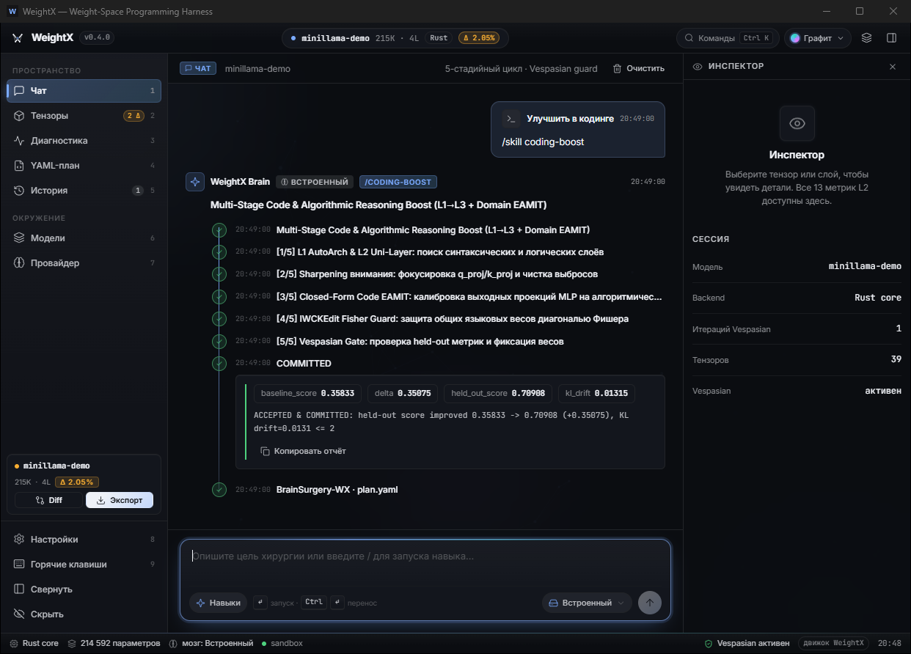

<div align="center">


# WeightX

**An open-source Weight-Space Programming (WSP) harness for safe, auditable LLM-guided surgery on neural network weights.**

[](LICENSE)
[](rust/)
[](https://www.python.org/downloads/)
[](https://github.com/nakoulaf4/WeightX/releases)
[](#testing)
[](#desktop-app--screenshots)

</div>

---

**WeightX** connects a strong reasoning model ("Brain" via API, CLI agent, or local runtime) to a sandboxed suite of weight-inspection, profiling, declarative surgery, and rollback tools. Rather than letting an LLM execute arbitrary Python against host filesystems, WeightX exposes deterministic, schema-validated WSP primitives for inspecting tensors, diagnosing bottleneck layers, applying closed-form / spectral / EAMIT / declarative YAML edits, and automatically rolling back regressions.

**Since v0.4.0 WeightX is a hybrid**: the product (CLI `wx`/`weightx`, Tauri Desktop, orchestration, TOON, YAML plans, workspace I/O) is a native **Rust** binary; heavy numerics (forward/backward, real-size EAMIT) run through a **PyTorch sidecar** that reuses the reference Python implementation. The Python package remains in the repo as the sidecar numeric library — it is no longer the user-facing application. Benchmarks and the rationale: [docs/benchmark_rust_vs_python.md](docs/benchmark_rust_vs_python.md).

---

## Desktop App & Screenshots

WeightX Desktop follows a minimalist dark canvas (`#151517` base, `#1B1B1C` collapsible sidebar, `#2C2C2E` rounded composer card, `#F9FAFB` crisp send trigger) designed for distraction-free weight surgery with on-demand inspection drawers and ultra-compact one-click **Skill Pills**.

<div align="center">

### Minimalist Home & Skill Pills


### Active Weight-Surgery Session & Inspector


</div>

---

## 8 Built-in WSP Skills (2-Word Pills)

On the home screen and inside the interactive CLI, WeightX surfaces ultra-compact two-word suggestion pills. Each pill triggers a full multi-step Weight-Space Programming pipeline and can also be invoked directly as a slash command (`/skill`) or CLI subcommand (`wx skill <id>`):

| Pill | Slash Command | WSP Pipeline & Focus |
| :--- | :--- | :--- |
| **Улучшить в кодинге** | `/coding-boost` | Attention / MLP diagnostic sweep + targeted coding projection refinement & perplexity verification |
| **Уменьшить память** | `/memory-slim` | Redundancy detection + low-rank / structured tensor compression with invariant checks |
| **Починить выбросы** | `/outlier-repair` | Weight-norm & kurtosis outlier scan + surgical clamp / rescaling in isolated sandbox |
| **Снизить перплексию** | `/spectral-denoise` | SVD spectral tail denoising on noisy projections + held-out perplexity regression gate |
| **Записать факты** | `/eamit-facts` | Batch closed-form factual knowledge injection via EAMIT embedding alignment without catastrophic forgetting |
| **Карта знаний** | `/knowledge-map` | Layer-wise Logit Lens & Knowledge Concentration Index localization report |
| **Вырезать отказы** | `/abliterate` | Refusal-direction extraction & orthogonal projection editing in sandboxed weights |
| **Проверить откат** | `/vespasian-guard` | Deliberate stress-test edit to verify **Vespasian** automatic invariant-failure rollback |

Skills are matched **case-insensitively** by slash ID (`/CODING-BOOST`), plain ID (`coding-boost`), pill label (`Улучшить в кодинге`), or unique prefix.

---

## Architecture (3 Isolated Layers)

1. **Provider Layer** — Universal interface to connect a reasoning "Brain":
   - **API providers**: OpenAI-compatible endpoints (OpenAI, OpenRouter, vLLM, LM Studio, Ollama) and Anthropic.
   - **CLI agents**: Claude Code, Codex, OpenCode, Antigravity, DSH, and compatible CLI adapters.
   - **Custom adapters**: Python callable / class hooks for custom orchestration.
2. **Tool Layer (L1 / L2 / L3 + Declarative Surgery)** — Structured schema-bound primitives:
   - **L1 Architecture Understanding**: AutoArch-style (`omnia-surgery` compatible) tensor role discovery (`q`/`k`/`v`/`o`), layer counting, and head-configuration disambiguation.
   - **L2 Layer Profiling**: Uni-Layer multi-metric profiling (13 per-layer metrics, bottleneck/redundancy detection) and `egora-diagnostics` Knowledge Map & Knowledge Concentration Index.
   - **L3 Tensor Read/Write & Closed-Form Edits**: `weightspace`-style tensor listing, SVD/norm descriptors, slice reading, and `weightsmith`-style closed-form gradient-free edits.
   - **Declarative YAML Surgery**: BrainSurgery-style declarative YAML plans with strict shape, dtype, and norm `assertions`.
   - **Batch Fact Editing**: EAMIT (Embedding Alignment Model Editing) batch editing path with KL + top-M similarity alignment to update many facts while limiting forgetting.
3. **Execution & Verification Layer** — Sandboxed staging + **Vespasian** verification loop:
   - Executes edits against isolated sandboxes before exporting checkpoints.
   - Enforces assertions and held-out checks; performs **automatic rollback** on regression or invariant violation.

Full architectural notes are available in [docs/ARCHITECTURE.md](docs/ARCHITECTURE.md) and third-party license details in [docs/LICENSE_COMPLIANCE.md](docs/LICENSE_COMPLIANCE.md).

### Hybrid Runtime (Rust + PyTorch sidecar)

| Component | Runtime | Why |
| :--- | :--- | :--- |
| CLI / REPL / Tauri Desktop / orchestration | **Rust** | ×14 faster startup, ×11 faster E2E demo |
| TOON, YAML plans, workspace I/O | **Rust** | ×2–4 faster, bit-identical results |
| Forward / backward on real models | **PyTorch sidecar** | MKL/oneDNN + CUDA (×3–9 vs pure Rust) |
| EAMIT on real-size matrices | **Python sidecar (numpy/LAPACK)** | LAPACK-grade linear solve, identical MSE |
| Small/demo models (MiniLlama) | **Rust** | ×7 faster than Python on small matrices |

Backend selection: `wx --backend rust|torch|auto` (default `auto`: sidecar for models ≥5M params).
Environment: `WEIGHTX_BACKEND`, `WEIGHTX_TORCH_DEVICE=cpu|cuda|auto`, `WEIGHTX_PYTHON`, `WEIGHTX_HOME`.
The sidecar is a persistent JSONL child process (`torch_worker.py`, embedded in the binary); weights sync
incrementally, results are bit-identical to the reference Python implementation on CPU.

---

## Model Improvement Benchmarks (`v0.4.0`)

All improvements are evaluated strictly on **disjoint held-out test splits** (`WikiText-2`, `LAMBADA`, `ARC-Easy`, `HellaSwag`, `SciQ`, `MBPP`, `HumanEval`, `CounterFact`) across 5 pretrained LLMs (`124M–494M` params) on an RTX 4060 (8 GB) plus `minillama-demo`. Full methodology, ablations, and tables: **[docs/MODEL_BENCHMARKS.md](docs/MODEL_BENCHMARKS.md)**.

<div align="center">

</div>

| Benchmark Axis | Evaluated Scope | Verified Result |
| :--- | :--- | :--- |
| **Zero-SGD Code Calibration (`MBPP`)** | 16 train → 200 held-out tests | **-19.4% to -67.5%** MBPP PPL reduction (`+5.5pp–6.9pp` Top-1); `qwen2.5-0.5b` beats 4-layer AdamW SGD (`3.35` vs `7.25` PPL, `+0.47%` WT2 drift) |
| **Zero-SGD Science QA (`SciQ`)** | 16 train → 500 4-choice / 300 text | **`+3.4pp to +10.8pp`** 4-choice `acc_norm` (`64.0% → 71.0%` on `qwen2.5-0.5b` with `+0.19%` WT2 drift & `+3.25pp` zero-shot `ARC-Easy`) |
| **Batch Fact Editing (`EAMIT` CounterFact)** | `N = 10 / 50 / 100` edits (4 models) | **90%–100%** efficacy at `N=10`, **70%–98%** at `N=100` (`98.0%` efficacy & `88.3%` specificity on `qwen2.5-0.5b`); **99.84%–99.94%** MSE reduction up to `N=500` |
| **Outlier Fault Repair (`/outlier-repair`)** | 3 corrupted rows (`12x–16x`) | **100% row recall** & **93.2%–100.0% WT2 recovery** (`0.0019%–0.0046%` params modified, Fisher Guard protected) |
| **Spectral Compression (`/memory-slim`)** | `svd_low_rank_` + `ties_trim_` `0.85` | **12.4%–52.7%** target-layer param saving across Pareto sweeps |
| **L2 Knowledge Map & Vespasian Guard** | `-50x` scale, `NaN`, KL noise attacks | Gini KCI `0.5230–0.6346`; **100% SHA-256 bit-exact rollback (`0.0e+00` diff)** across all 5 models |

---

## Case-Insensitive CLI (`wx` / `weightx`) & TUI

Both `wx` and `weightx` resolve identically and **ignore letter case** (`wx`, `WX`, `Wx`, `weightx`, `WeightX`, `WEIGHTX`), as do all subcommands and skill names:

```powershell
# Launch interactive DSH-styled CLI REPL
wx
WEIGHTX

# Browse built-in skills, prompt suggestions, and model catalog
WX skills
WeightX prompts
wx catalog

# Run a full WSP skill directly from the terminal
wx skill coding-boost
WX /MEMORY-SLIM
WeightX skill vespasian-guard

# Launch the WeightX Desktop GUI
wx desktop
```

Built-in demo and starter models in the catalog include `minillama-demo`, `tiny-gpt2`, `smollm2-135m`, `qwen2.5-0.5b`, and additional lightweight targets, plus an example improved checkpoint in [checkpoints/smollm2-135m_weightx_improved.safetensors](checkpoints/smollm2-135m_weightx_improved.safetensors).

---

## Installation & Quickstart

### Windows Standalone Releases (`v0.4.0`, hybrid)

Prebuilt native binaries are produced by `scripts/build_release.py` into `dist/`:

- **`WeightX-v0.4.0-win64.exe`** — WeightX Desktop (Tauri) GUI executable (`WeightX.lnk` on Desktop).
- **`wx-cli-v0.4.0-win64.exe`** — Standalone WeightX CLI (`wx` / `weightx`), native Rust.
- **`WeightX-v0.4.0-win64-portable.zip`** — Portable bundle: `WeightX.exe` (GUI), `bin/wx.exe`, `bin/weightx.exe`, the Python sidecar library (`src/weightx/`), launchers, and docs.
- **`weightx-0.4.0-py3-none-any.whl`** — Python wheel: sidecar numeric library + `wx`/`weightx` entry-point shims that exec the Rust binary.

> The CLI/GUI are native Rust binaries. The Python sidecar (PyTorch/numpy) is loaded on demand for heavy numerics on large models; it requires a Python env with `torch`, `safetensors`, `numpy`, `transformers`. On Windows NTFS (case-insensitive), the GUI (`dist/gui/WeightX.exe`) is kept separate from the CLI shims (`dist/cli/wx.exe`, `dist/cli/weightx.exe`) so `weightx` in a terminal always runs the CLI while Desktop shortcuts open the GUI.

### From Source

```powershell
git clone https://github.com/nakoulaf4/WeightX.git
cd WeightX

# 1. Python sidecar env (numeric library used by the hybrid backend)
python -m venv .venv
.\.venv\Scripts\Activate.ps1
pip install -e ".[dev,integrations]"

# 2. Build the native Rust product (CLI + Tauri Desktop)
cd rust
cargo build --release -p wx-cli --bin wx --bin wx-bench
cargo build --release -p weightx-desktop
cd ..

# 3. Assemble dist/, refresh Desktop shortcuts + global wx/weightx shims, build wheel & portable zip
.\.venv\Scripts\python.exe scripts\build_release.py

# Run Desktop or CLI (native Rust; auto-selects the torch sidecar for large models)
wx desktop
wx skills
wx --backend torch improve smollm2-135m
```

---

## Building Releases & Testing

<a id="testing"></a>

```powershell
# Rust test suite (core + hybrid parity tests; 26 tests)
cd rust; cargo test --workspace; cd ..

# Python sidecar/reference test suite
.\.venv\Scripts\pytest.exe -v

# Build Windows GUI/CLI binaries, wheel, portable archive, and refresh Desktop shortcuts
.\.venv\Scripts\python.exe scripts/build_release.py
```

> **Legacy Python app:** the original pure-Python CLI/TUI/Desktop (`weightx.cli`, `weightx.tui`,
> `weightx.desktop`) is retained in `src/weightx/` as the reference implementation and sidecar
> library, but is no longer the shipped product. The `wx`/`weightx` commands and Desktop shortcuts
> now launch the Rust hybrid. To run the legacy Python CLI explicitly: `python -m weightx.cli`.

---

## License

WeightX is free software licensed under the **GNU General Public License v3.0 or later** ([LICENSE](LICENSE)). See [docs/LICENSE_COMPLIANCE.md](docs/LICENSE_COMPLIANCE.md) for upstream component attribution and MIT/GPL compatibility notes.
