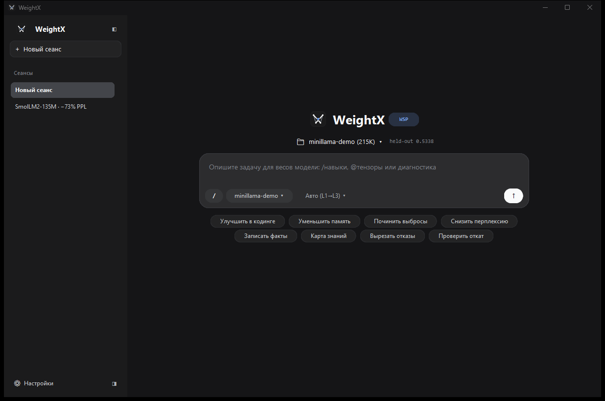

<div align="center">


# WeightX

**An open-source Weight-Space Programming (WSP) harness for safe, auditable LLM-guided surgery on neural network weights.**

[](LICENSE)
[](https://www.python.org/downloads/)
[](https://github.com/nakoulaf4/WeightX/releases/tag/v0.3.0)
[](#testing)
[](#desktop-app--screenshots)

</div>

---

**WeightX** connects a strong reasoning model ("Brain" via API, CLI agent, or local runtime) to a sandboxed suite of weight-inspection, profiling, declarative surgery, and rollback tools. Rather than letting an LLM execute arbitrary Python against host filesystems, WeightX exposes deterministic, schema-validated WSP primitives for inspecting tensors, diagnosing bottleneck layers, applying closed-form / spectral / MEMIT-MASS / declarative YAML edits, and automatically rolling back regressions.

---

## Desktop App & Screenshots

WeightX Desktop follows a minimalist dark canvas (`#151517` base, `#1B1B1C` collapsible sidebar, `#2C2C2E` rounded composer card, `#F9FAFB` crisp send trigger) designed for distraction-free weight surgery with on-demand inspection drawers and ultra-compact one-click **Skill Pills**.

<div align="center">

### Minimalist Home & Skill Pills


### Active Weight-Surgery Session & Inspector


</div>

---

## 8 Built-in WSP Skills (2-Word Pills)

On the home screen and inside the interactive CLI, WeightX surfaces ultra-compact two-word suggestion pills. Each pill triggers a full multi-step Weight-Space Programming pipeline and can also be invoked directly as a slash command (`/skill`) or CLI subcommand (`wx skill <id>`):

| Pill | Slash Command | WSP Pipeline & Focus |
| :--- | :--- | :--- |
| **Улучшить в кодинге** | `/coding-boost` | Attention / MLP diagnostic sweep + targeted coding projection refinement & perplexity verification |
| **Уменьшить память** | `/memory-slim` | Redundancy detection + low-rank / structured tensor compression with invariant checks |
| **Починить выбросы** | `/outlier-repair` | Weight-norm & kurtosis outlier scan + surgical clamp / rescaling in isolated sandbox |
| **Снизить перплексию** | `/spectral-denoise` | SVD spectral tail denoising on noisy projections + held-out perplexity regression gate |
| **Записать факты** | `/memit-facts` | Batch closed-form factual knowledge injection (MEMIT-MASS style) without catastrophic forgetting |
| **Карта знаний** | `/knowledge-map` | Layer-wise Logit Lens & Knowledge Concentration Index localization report |
| **Вырезать отказы** | `/abliterate` | Refusal-direction extraction & orthogonal projection editing in sandboxed weights |
| **Проверить откат** | `/vespasian-guard` | Deliberate stress-test edit to verify **Vespasian** automatic invariant-failure rollback |

Skills are matched **case-insensitively** by slash ID (`/CODING-BOOST`), plain ID (`coding-boost`), pill label (`Улучшить в кодинге`), or unique prefix.

---

## Architecture (3 Isolated Layers)

1. **Provider Layer** — Universal interface to connect a reasoning "Brain":
   - **API providers**: OpenAI-compatible endpoints (OpenAI, OpenRouter, vLLM, LM Studio, Ollama) and Anthropic.
   - **CLI agents**: Claude Code, Codex, OpenCode, Antigravity, DSH, and compatible CLI adapters.
   - **Custom adapters**: Python callable / class hooks for custom orchestration.
2. **Tool Layer (L1 / L2 / L3 + Declarative Surgery)** — Structured schema-bound primitives:
   - **L1 Architecture Understanding**: AutoArch-style (`omnia-surgery` compatible) tensor role discovery (`q`/`k`/`v`/`o`), layer counting, and head-configuration disambiguation.
   - **L2 Layer Profiling**: Uni-Layer multi-metric profiling (13 per-layer metrics, bottleneck/redundancy detection) and `egora-diagnostics` Knowledge Map & Knowledge Concentration Index.
   - **L3 Tensor Read/Write & Closed-Form Edits**: `weightspace`-style tensor listing, SVD/norm descriptors, slice reading, and `weightsmith`-style closed-form gradient-free edits.
   - **Declarative YAML Surgery**: BrainSurgery-style declarative YAML plans with strict shape, dtype, and norm `assertions`.
   - **Batch Fact Editing**: MEMIT-MASS batch editing path to update many facts while limiting forgetting.
3. **Execution & Verification Layer** — Sandboxed staging + **Vespasian** verification loop:
   - Executes edits against isolated sandboxes before exporting checkpoints.
   - Enforces assertions and held-out checks; performs **automatic rollback** on regression or invariant violation.

Full architectural notes are available in [docs/ARCHITECTURE.md](docs/ARCHITECTURE.md) and third-party license details in [docs/LICENSE_COMPLIANCE.md](docs/LICENSE_COMPLIANCE.md).

---

## Case-Insensitive CLI (`wx` / `weightx`) & TUI

Both `wx` and `weightx` resolve identically and **ignore letter case** (`wx`, `WX`, `Wx`, `weightx`, `WeightX`, `WEIGHTX`), as do all subcommands and skill names:

```powershell
# Launch interactive DSH-styled CLI REPL
wx
WEIGHTX

# Browse built-in skills, prompt suggestions, and model catalog
WX skills
WeightX prompts
wx catalog

# Run a full WSP skill directly from the terminal
wx skill coding-boost
WX /MEMORY-SLIM
WeightX skill vespasian-guard

# Launch the WeightX Desktop GUI
wx desktop
```

Built-in demo and starter models in the catalog include `minillama-demo`, `tiny-gpt2`, `smollm2-135m`, `qwen2.5-0.5b`, and additional lightweight targets, plus an example improved checkpoint in [checkpoints/smollm2-135m_weightx_improved.safetensors](checkpoints/smollm2-135m_weightx_improved.safetensors).

---

## Installation & Quickstart

### Windows Standalone Releases (`v0.3.0`)

Prebuilt binaries and installers are published on [GitHub Releases](https://github.com/nakoulaf4/WeightX/releases/tag/v0.3.0):

- **`WeightX-v0.3.0-win64.exe`** — WeightX Desktop GUI executable (`WeightX.lnk` on Desktop).
- **`wx-cli-v0.3.0-win64.exe`** — Standalone WeightX CLI wrapper (`wx` / `weightx`).
- **`WeightX-v0.3.0-win64-portable.zip`** — Portable bundle containing separated `gui/WeightX.exe`, `cli/wx.exe`, `cli/weightx.exe`, source, and icons.
- **`weightx-0.3.0-py3-none-any.whl`** — Python wheel package.

> On Windows NTFS (case-insensitive filesystem), WeightX installs the Desktop GUI executable (`dist/gui/WeightX.exe`) separately from the CLI shims (`dist/cli/wx.exe` and `dist/cli/weightx.exe`) so invoking `weightx` or `WeightX` in a terminal always runs the CLI while Desktop shortcuts open the GUI cleanly.

### From Source

```powershell
git clone https://github.com/nakoulaf4/WeightX.git
cd WeightX
python -m venv .venv
.\.venv\Scripts\Activate.ps1
pip install -e ".[dev]"

# Install Desktop shortcut (WeightX.lnk) and global CLI shims (~/.local/bin/wx, weightx)
python -c "from weightx.desktop_installer import install_desktop_shortcut; print(install_desktop_shortcut())"

# Run Desktop or CLI
wx desktop
wx skills
```

---

## Building Releases & Testing

<a id="testing"></a>

```powershell
# Run the test suite
.\.venv\Scripts\pytest.exe -v

# Build Windows GUI/CLI binaries, wheel, portable archive, and refresh Desktop shortcuts
.\.venv\Scripts\python.exe scripts/build_release.py
```

---

## License

WeightX is free software licensed under the **GNU General Public License v3.0 or later** ([LICENSE](LICENSE)). See [docs/LICENSE_COMPLIANCE.md](docs/LICENSE_COMPLIANCE.md) for upstream component attribution and MIT/GPL compatibility notes.
