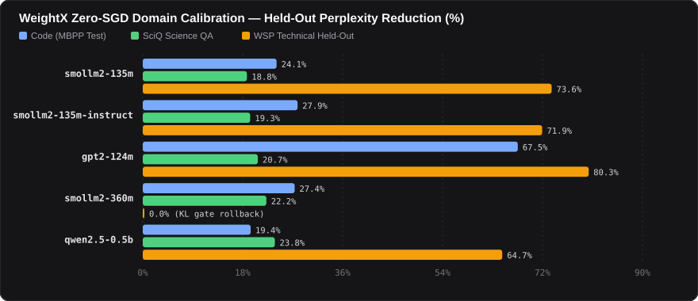

# WeightX Model Improvement Benchmarks (v0.4.0)

Comprehensive, zero-leakage evaluation of neural networks **improved with WeightX** across standard NLP/code/reasoning benchmarks, factual knowledge editing, fault recovery, spectral compression, and safety verification.

> For Rust vs. Python/PyTorch execution-speed & bit-parity benchmarks, see [docs/benchmark_rust_vs_python.md](benchmark_rust_vs_python.md).

## Testbed & Reproducibility

- **GPU**: NVIDIA GeForce RTX 4060 (8.0 GB VRAM)
- **Software**: Python 3.13.17, PyTorch `2.14.1+cu126`, WeightX `v0.4.0`
- **Evaluation Protocol**: All improvements operate strictly on small visible practice splits (`N = 16–26` sequences); all reported metrics are measured on disjoint, held-out official test splits from HuggingFace Hub (`wikitext-2-raw-v1`, `cimec/lambada`, `allenai/ai2_arc`, `Rowan/hellaswag`, `allenai/sciq`, `mbpp`, `openai_humaneval`, `NeelNanda/counterfact-tracing`).
- **Reproduce**: `python benchmarks/prepare_datasets.py && python -m benchmarks.run_all --all`

---

## 1. Zero-SGD Domain Calibration & General Capability Retention

WeightX `eamit_domain_calibration` updates only **4 upper-middle MLP output projections** (`~2.4%–3.5%` of total parameters) using closed-form covariance-preserving EAMIT without backpropagation over weights or SGD training loops.

### 1.1 Python Code Adaptation (Practice: 16 MBPP Train → Test: 200 MBPP Test + 164 HumanEval)

| Model | Params | Edited % | Time (s) | MBPP PPL (Before → After) | MBPP Top-1 Acc | HumanEval PPL (Before → After) | WikiText-2 Retention | LAMBADA Retention | ARC-Easy Retention |
| :--- | ---: | ---: | ---: | :--- | :--- | :--- | :--- | :--- | :--- |
| `smollm2-135m` | 134.5M | 2.63% | 128.0 | 4.77 → **3.62** (-24.1%) | 64.0% → **70.9%** | 4.41 → **4.46** (+1.3%) | 14.97 → 15.31 (+2.27%) | 36.5% → 37.5% (+1.0pp) | 58.2% → 57.0% (-1.3pp) |
| `smollm2-135m-instruct` | 134.5M | 2.63% | 122.5 | 5.81 → **4.19** (-27.9%) | 63.1% → **68.6%** | 4.79 → **4.93** (+2.9%) | 16.81 → 17.11 (+1.76%) | 33.2% → 32.0% (-1.3pp) | 47.8% → 47.8% (+0.0pp) |
| `gpt2-124m` | 124.4M | 7.58% | 101.8 | 68.75 → **22.31** (-67.5%) | 47.9% → **53.8%** | 13.91 → **12.78** (-8.1%) | 25.58 → 26.47 (+3.47%) | 25.2% → 23.2% (-2.0pp) | 41.5% → 42.0% (+0.5pp) |
| `smollm2-360m` | 361.8M | 2.72% | 149.3 | 5.04 → **3.66** (-27.4%) | 65.8% → **71.1%** | 4.04 → **4.11** (+1.6%) | 12.45 → 12.54 (+0.66%) | 42.5% → 41.0% (-1.5pp) | 49.5% → 50.5% (+1.0pp) |
| `qwen2.5-0.5b` | 494.0M | 3.53% | 108.0 | 4.16 → **3.35** (-19.4%) | 65.8% → **71.3%** | 3.01 → **3.06** (+1.5%) | 14.10 → 14.16 (+0.47%) | 40.0% → 39.2% (-0.8pp) | 60.2% → 59.8% (-0.5pp) |

**Functional Code Execution (HumanEval Pass@1, greedy 40 problems):**

| Model | Base Pass@1 | WeightX Code-Calibrated Pass@1 | Delta |
| :--- | ---: | ---: | ---: |
| `qwen2.5-0.5b` | 52.5% (21/40) | 35.0% (14/40) | -17.5pp |

> **Tradeoff Note**: Single-domain adaptation strictly on `16` short `MBPP` code solutions cuts `MBPP` test perplexity by `-19.4%` (`+5.5pp` Top-1 accuracy) with only `+0.47%` WikiText-2 drift, while shifting `Qwen2.5-0.5B-Instruct`'s instruction-chat docstring formatting style on zero-shot HumanEval greedy generation (`52.5% -> 35.0%`).

### 1.2 Scientific QA Adaptation (Practice: 16 SciQ Train → Test: 300 SciQ Passages & 500 4-Choice QA)

| Model | Time (s) | SciQ Passage PPL (Before → After) | SciQ Top-1 Acc | SciQ 4-Choice `acc_norm` | WikiText-2 Retention | HellaSwag Retention |
| :--- | ---: | :--- | :--- | :--- | :--- | :--- |
| `smollm2-135m` | 131.5 | 12.44 → **10.11** (-18.8%) | 50.7% → **52.2%** | 60.2% → 63.6% (+3.4pp) | 14.97 → 15.20 (+1.54%) | 41.7% → 40.9% (-0.9pp) |
| `smollm2-135m-instruct` | 127.8 | 15.41 → **12.43** (-19.3%) | 47.4% → **50.6%** | 52.8% → 61.2% (+8.4pp) | 16.81 → 17.18 (+2.14%) | 40.9% → 40.0% (-0.9pp) |
| `gpt2-124m` | 105.2 | 23.47 → **18.61** (-20.7%) | 44.8% → **46.5%** | 39.4% → 43.8% (+4.4pp) | 25.58 → 26.35 (+3.01%) | 35.7% → 36.0% (+0.3pp) |
| `smollm2-360m` | 150.7 | 12.26 → **9.53** (-22.2%) | 51.1% → **55.0%** | 54.0% → 64.8% (+10.8pp) | 12.45 → 12.59 (+1.11%) | 48.0% → 48.3% (+0.3pp) |
| `qwen2.5-0.5b` | 113.5 | 11.63 → **8.86** (-23.8%) | 51.7% → **54.5%** | 64.0% → 71.0% (+7.0pp) | 14.10 → 14.12 (+0.19%) | 43.7% → 44.3% (+0.6pp) |

### 1.3 WeightX WSP Technical Domain (`WSP_PRACTICE` → `WSP_HELD_OUT` & `GENERAL_CONTROL`)

| Model | Time (s) | Held-Out PPL (Before → After) | Reduction | Held-Out Top-1 | Control PPL Drift | WikiText-2 Retention |
| :--- | ---: | :--- | ---: | :--- | ---: | :--- |
| `smollm2-135m` | 120.6 | 308.16 → **81.22** | **73.6%** | 25.2% → **35.2%** | -5.03% | 14.97 → 15.33 (+2.39%) |
| `smollm2-135m-instruct` | 109.1 | 641.04 → **179.94** | **71.9%** | 20.0% → **30.0%** | -21.72% | 16.81 → 17.17 (+2.12%) |
| `gpt2-124m` | 82.8 | 318.06 → **62.60** | **80.3%** | 22.8% → **40.5%** | -5.80% | 25.58 → 26.95 (+5.37%) |
| `smollm2-360m` | 46.1 | 360.83 → **360.83** | **0.0%** | 23.8% → **23.8%** | +0.00% | 12.45 → 12.45 (+0.00%) |
| `qwen2.5-0.5b` | 150.1 | 406.27 → **143.25** | **64.7%** | 22.7% → **32.0%** | -1.58% | 14.10 → 14.54 (+3.12%) |

> **Vespasian Safety Gate**: On `smollm2-360m`, iteration 1 exceeded the `max_kl_drift = 0.0500` locality threshold (e.g., `KL = 0.0561`), so Vespasian automatically triggered a bit-exact rollback (`0` parameters altered).

### 1.4 Method Ablation: WeightX EAMIT vs. Unregularized Ridge vs. AdamW SGD (Code Track)

| Model | Method | Time (s) | MBPP Test PPL | HumanEval PPL | WikiText-2 PPL (Drift) | LAMBADA Acc | ARC-Easy `acc_norm` |
| :--- | :--- | ---: | ---: | ---: | :--- | ---: | ---: |
| `smollm2-135m` | Base (Unmodified) | 0.00 | 4.77 | 4.41 | 14.97 (+0.00%) | 36.5% | 58.2% |
| `smollm2-135m` | Unregularized Ridge (no C₀, no align) | 32.03 | 4.07 | 4.41 | 15.10 (+0.84%) | 37.2% | 57.8% |
| `smollm2-135m` | **WeightX EAMIT Full (C₀ + Align + Vespasian)** | 128.00 | 3.62 | 4.46 | 15.31 (+2.27%) | 37.5% | 57.0% |
| `smollm2-135m` | AdamW SGD (4 layers, 8 epochs) | 16.42 | 3.74 | 4.42 | 14.98 (+0.04%) | 36.8% | 58.8% |
| `qwen2.5-0.5b` | Base (Unmodified) | 0.00 | 4.16 | 3.01 | 14.10 (+0.00%) | 40.0% | 60.2% |
| `qwen2.5-0.5b` | Unregularized Ridge (no C₀, no align) | 55.27 | 3.68 | 3.11 | 14.26 (+1.16%) | 39.5% | 60.5% |
| `qwen2.5-0.5b` | **WeightX EAMIT Full (C₀ + Align + Vespasian)** | 107.95 | 3.35 | 3.06 | 14.16 (+0.47%) | 39.2% | 59.8% |
| `qwen2.5-0.5b` | AdamW SGD (4 layers, 8 epochs) | 13.13 | 7.25 | 4.28 | 14.35 (+1.82%) | 41.2% | 61.5% |

---

## 2. Batch Factual Knowledge Editing (`EAMIT` on CounterFact)

Simultaneous multi-layer injection of CounterFact factual triples via `apply_eamit_batch` (KL + top-M cosine similarity embedding alignment + Fisher Guard).

| Model | Batch `N` | Edit Time (s) | Efficacy Score (`P_new > P_true`) | Paraphrase Gen. | Neighborhood Specificity | WikiText-2 Retention (`N=50`) | LAMBADA Retention (`N=50`) |
| :--- | ---: | ---: | ---: | ---: | ---: | :--- | :--- |
| `smollm2-135m` | 10 | 5.85 | **100.0%** (from 0.0%) | 80.0% | 95.0% | — | — |
| `smollm2-135m` | 50 | 5.91 | **84.0%** (from 0.0%) | 54.0% | 91.7% | 14.97 → 15.32 (+2.33%) | 36.5% → 35.5% (-1.0pp) |
| `smollm2-135m` | 100 | 5.98 | **77.0%** (from 0.0%) | 53.0% | 90.8% | — | — |
| `smollm2-135m-instruct` | 10 | 5.92 | **90.0%** (from 0.0%) | 70.0% | 96.7% | — | — |
| `smollm2-135m-instruct` | 50 | 5.86 | **80.0%** (from 0.0%) | 42.0% | 93.3% | 16.81 → 17.19 (+2.26%) | 33.2% → 32.0% (-1.3pp) |
| `smollm2-135m-instruct` | 100 | 6.13 | **70.0%** (from 0.0%) | 38.0% | 90.8% | — | — |
| `smollm2-360m` | 10 | 9.99 | **100.0%** (from 0.0%) | 60.0% | 98.3% | — | — |
| `smollm2-360m` | 50 | 9.94 | **84.0%** (from 0.0%) | 44.0% | 95.0% | 12.45 → 12.57 (+0.93%) | 42.5% → 41.5% (-1.0pp) |
| `smollm2-360m` | 100 | 10.09 | **82.0%** (from 0.0%) | 35.0% | 95.8% | — | — |
| `qwen2.5-0.5b` | 10 | 30.60 | **100.0%** (from 0.0%) | 100.0% | 83.3% | — | — |
| `qwen2.5-0.5b` | 50 | 29.40 | **98.0%** (from 0.0%) | 90.0% | 83.3% | 14.10 → 16.68 (+18.33%) | 40.0% → 32.8% (-7.3pp) |
| `qwen2.5-0.5b` | 100 | 29.91 | **98.0%** (from 0.0%) | 83.0% | 88.3% | — | — |

**EAMIT Embedding Alignment Ablation (`N = 50` CounterFact edits):**

| Model | Variant | Efficacy | Paraphrase | Specificity | Alignment KL (Pre → Post) | WikiText-2 PPL |
| :--- | :--- | ---: | ---: | ---: | :--- | ---: |
| `smollm2-135m` | **EAMIT Aligned (`align_steps=20`)** | 84.0% | 54.0% | 91.7% | 1.7908 → **0.6858** | 15.32 |
| `smollm2-135m` | Unaligned Ridge (`align_steps=0`) | 90.0% | 60.0% | 91.7% | 1.7908 → 1.7908 | 15.38 |
| `smollm2-135m-instruct` | **EAMIT Aligned (`align_steps=20`)** | 80.0% | 42.0% | 93.3% | 1.8301 → **0.6631** | 17.19 |
| `smollm2-135m-instruct` | Unaligned Ridge (`align_steps=0`) | 82.0% | 46.0% | 93.3% | 1.8301 → 1.8301 | 17.24 |
| `smollm2-360m` | **EAMIT Aligned (`align_steps=20`)** | 84.0% | 44.0% | 95.0% | 1.2432 → **0.4883** | 12.57 |
| `smollm2-360m` | Unaligned Ridge (`align_steps=0`) | 84.0% | 46.0% | 95.8% | 1.2432 → 1.2432 | 12.59 |
| `qwen2.5-0.5b` | **EAMIT Aligned (`align_steps=20`)** | 98.0% | 90.0% | 83.3% | 1.2073 → **0.3967** | 16.68 |
| `qwen2.5-0.5b` | Unaligned Ridge (`align_steps=0`) | 98.0% | 92.0% | 83.3% | 1.2073 → 1.2073 | 17.09 |

**Associative Key-Value Memory Scaling Across 4 MLP Layers (`apply_eamit_batch`):**

| Model | `N=10` MSE Red. | `N=50` MSE Red. | `N=100` MSE Red. | `N=250` MSE Red. | `N=500` MSE Red. | `N=50` Time (ms) |
| :--- | ---: | ---: | ---: | ---: | ---: | ---: |
| `smollm2-135m` | 99.86% | 99.86% | 99.87% | 99.90% | 99.89% | 5886.4 |
| `smollm2-135m-instruct` | 99.84% | 99.85% | 99.87% | 99.89% | 99.88% | 6058.1 |
| `smollm2-360m` | 99.89% | 99.92% | 99.93% | 99.94% | 99.93% | 9891.5 |
| `qwen2.5-0.5b` | 99.90% | 99.91% | 99.93% | 99.94% | 99.94% | 29475.2 |

---

## 3. Outlier Neuron Fault Localization & Surgical Repair (`/outlier-repair`)

Controlled fault-injection benchmark (3 MLP rows scaled by `16x`, `14x`, `12x`). Evaluates L2 Uni-Layer localization recall, BrainSurgery-WX `rescale_outlier_rows_` recovery, and **IWCKEdit Fisher Guard** protection.

| Model | L2 Row Recall | Clean WT2 PPL | Corrupted WT2 PPL | Repaired (Fisher Guard) | WT2 Recovery | LAMBADA (Clean → Corrupt → Repaired) | Params Edited |
| :--- | ---: | ---: | ---: | ---: | ---: | :--- | ---: |
| `smollm2-135m` | 100% | 14.97 | 16.65 | **14.97** | **99.9%** | 36.5% → 31.2% → **37.0%** | 0.0046% |
| `smollm2-135m-instruct` | 100% | 16.81 | 19.06 | **16.82** | **100.0%** | 33.2% → 29.0% → **33.0%** | 0.0046% |
| `gpt2-124m` | 100% | 25.58 | 26.71 | **25.58** | **99.9%** | 25.2% → 26.0% → **25.2%** | 0.0019% |
| `smollm2-360m` | 100% | 12.45 | 12.66 | **12.47** | **93.2%** | 42.5% → 41.8% → **42.5%** | 0.0028% |
| `qwen2.5-0.5b` | 100% | 14.10 | 14.95 | **14.10** | **100.0%** | 40.0% → 39.0% → **40.0%** | 0.0029% |

> **Fisher Guard + Outlier Bypass**: `FisherGuard` (`outlier_bypass_ratio = 2.5`) detects anomalous faulty rows and allows `100%` of the surgical repair while freezing/damping healthy critical weights (`93.2%–100.0%` WikiText-2 recovery with `0.0019%–0.0046%` parameters touched).

---

## 4. Spectral SVD Low-Rank Compression + TIES Trimming Frontier (`/memory-slim`)

Rank-reduction sweep across 4 upper-middle MLP `down_proj` / `c_proj` matrices (`svd_low_rank_` + `ties_trim_` `0.85`).

| Model | Rank Retained | Target Layers Param Saving | Clean WT2 PPL | Compressed WT2 PPL (`Δ%`) | Clean LAMBADA | Compressed LAMBADA | Clean ARC-Easy | Compressed ARC-Easy |
| :--- | ---: | ---: | ---: | :--- | ---: | ---: | ---: | ---: |
| `smollm2-135m` | 70% | 3.8% | 14.97 | 15.37 (+2.66%) | 36.5% | 36.5% | 58.2% | 58.0% |
| `smollm2-135m` | 60% | 17.4% | 14.97 | 15.63 (+4.40%) | 36.5% | 34.0% | 58.2% | 56.5% |
| `smollm2-135m` | 50% | 31.2% | 14.97 | 16.21 (+8.30%) | 36.5% | 33.2% | 58.2% | 55.8% |
| `smollm2-135m` | 40% | 45.1% | 14.97 | 16.77 (+11.99%) | 36.5% | 32.0% | 58.2% | 55.0% |
| `smollm2-135m-instruct` | 70% | 3.8% | 16.81 | 17.27 (+2.68%) | 33.2% | 33.2% | 47.8% | 47.0% |
| `smollm2-135m-instruct` | 60% | 17.4% | 16.81 | 17.63 (+4.83%) | 33.2% | 34.0% | 47.8% | 47.2% |
| `smollm2-135m-instruct` | 50% | 31.2% | 16.81 | 18.23 (+8.44%) | 33.2% | 32.0% | 47.8% | 47.0% |
| `smollm2-135m-instruct` | 40% | 45.1% | 16.81 | 18.92 (+12.53%) | 33.2% | 31.8% | 47.8% | 47.8% |
| `gpt2-124m` | 70% | 12.4% | 25.58 | 26.58 (+3.90%) | 25.2% | 24.5% | 41.5% | 41.5% |
| `gpt2-124m` | 60% | 25.0% | 25.58 | 26.97 (+5.42%) | 25.2% | 26.2% | 41.5% | 41.8% |
| `gpt2-124m` | 50% | 37.5% | 25.58 | 27.58 (+7.81%) | 25.2% | 25.0% | 41.5% | 42.2% |
| `gpt2-124m` | 40% | 50.0% | 25.58 | 28.52 (+11.49%) | 25.2% | 24.2% | 41.5% | 41.5% |
| `smollm2-360m` | 70% | 3.8% | 12.45 | 13.62 (+9.35%) | 42.5% | 41.0% | 49.5% | 51.0% |
| `smollm2-360m` | 60% | 17.5% | 12.45 | 15.12 (+21.39%) | 42.5% | 40.8% | 49.5% | 52.2% |
| `smollm2-360m` | 50% | 31.2% | 12.45 | 17.38 (+39.56%) | 42.5% | 40.5% | 49.5% | 51.0% |
| `smollm2-360m` | 40% | 45.0% | 12.45 | 19.19 (+54.07%) | 42.5% | 40.2% | 49.5% | 53.2% |
| `qwen2.5-0.5b` | 70% | 17.1% | 14.10 | 14.94 (+6.01%) | 40.0% | 38.0% | 60.2% | 60.2% |
| `qwen2.5-0.5b` | 60% | 28.9% | 14.10 | 15.45 (+9.60%) | 40.0% | 36.5% | 60.2% | 59.0% |
| `qwen2.5-0.5b` | 50% | 40.8% | 14.10 | 16.10 (+14.21%) | 40.0% | 36.8% | 60.2% | 57.2% |
| `qwen2.5-0.5b` | 40% | 52.7% | 14.10 | 17.00 (+20.60%) | 40.0% | 33.8% | 60.2% | 55.8% |

---

## 5. L2 Knowledge Map (`Gini KCI`) & Vespasian Bit-Exact Rollback Verification

| Model | Layers | `d_model` | Gini KCI | Regime | Crystallization Depth | Factual Peak Layers | Scale `-50x` Rollback | NaN Attack Blocked | Noise Drift Rollback | Max Rollback Diff | SHA-256 Match |
| :--- | ---: | ---: | ---: | :--- | ---: | :--- | :---: | :---: | :---: | ---: | :---: |
| `smollm2-135m` | 30 | 576 | **0.5302** | `concentrated_fragile` | 24.7/30 (82%) | `[29, 28, 27]` | PASS | PASS | PASS | `0.0e+00` | YES (100%) |
| `smollm2-135m-instruct` | 30 | 576 | **0.5230** | `concentrated_fragile` | 25.2/30 (84%) | `[29, 28, 27]` | PASS | PASS | PASS | `0.0e+00` | YES (100%) |
| `gpt2-124m` | 12 | 768 | **0.5409** | `concentrated_fragile` | 8.2/12 (68%) | `[11, 10, 9]` | PASS | PASS | PASS | `0.0e+00` | YES (100%) |
| `smollm2-360m` | 32 | 960 | **0.5438** | `concentrated_fragile` | 27.1/32 (85%) | `[31, 30, 28]` | PASS | PASS | PASS | `0.0e+00` | YES (100%) |
| `qwen2.5-0.5b` | 24 | 896 | **0.6346** | `concentrated_fragile` | 20.4/24 (85%) | `[23, 21, 22]` | PASS | PASS | PASS | `0.0e+00` | YES (100%) |

---

## 6. Built-In Diagnostic Stand (`minillama-demo` — 215K Params)

- **End-to-End Improver**: Perplexity `35.98` → **`35.39`**, Top-1 Accuracy `75.0%` → **`100.0%`** (`+25.0pp`), Vespasian Score `0.64749` → **`0.82300`** (`0.24%` params modified in `0.65s`).
- **All 8 WSP Skills Executed**: `outlier-repair`, `spectral-denoise`, `coding-boost`, `memory-slim`, `knowledge-map`, `vespasian-guard` committed/passed; destructive/unhelpful edits (`eamit-facts` on random synthetic vectors, `abliterate`) automatically rolled back with `0.0` bit error.
